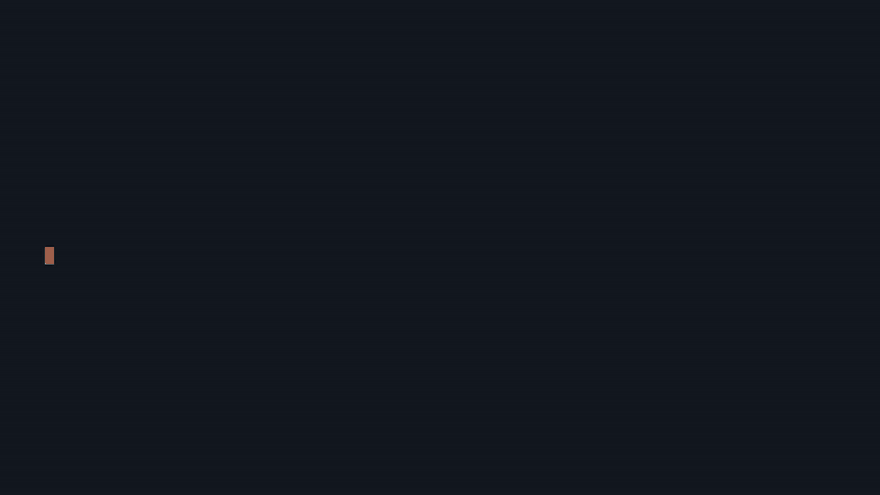
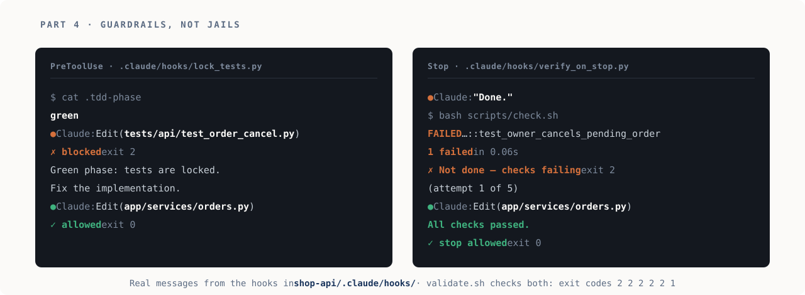
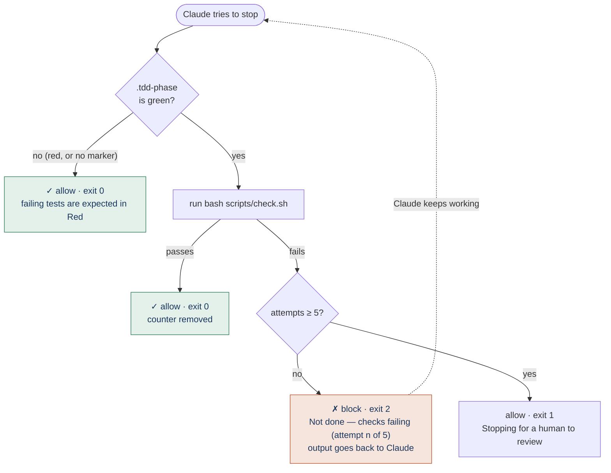
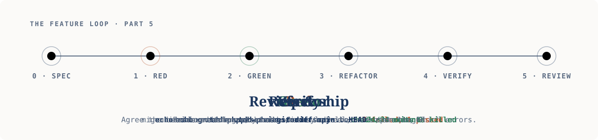
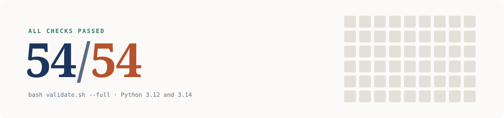

<picture>
  <source media="(prefers-color-scheme: dark)" srcset="assets/banner-dark.svg">
  
</picture>

<p align="center">
  <a href="docs/VERIFY.md"></a>
  
  
  <a href="LICENSE"></a>
</p>

<p align="center">
  <a href="book/Test-Driven-Backend-Development-with-Claude-Code.pdf"><b>📖 Read the book (PDF)</b></a>
  &nbsp;·&nbsp;
  <a href="https://dannyude.github.io/tdd-backend-claude-code/"><b>✨ Interactive companion site</b></a>
  &nbsp;·&nbsp;
  <a href="docs/GUIDE.md">🧭 How to use this book</a>
  &nbsp;·&nbsp;
  <a href="docs/VERIFY.md">✅ Verify it yourself</a>
</p>

---

The companion repository for the book by **Daniel Ude**. The book teaches one complete, repeatable way to build backend features with Claude Code, so that **Claude proves its own work with tests before anything is called done** — and carries that proof all the way to GitHub, where every change is checked automatically and shipped when it passes.

<p align="center">
  <a href="https://dannyude.github.io/tdd-backend-claude-code/#proof">
    
  </a>
  <br>
  <sub>A replay of <code>bash validate.sh --full</code> — real rows, in their real order, abridged to 26 seconds. <a href="assets/hero.mp4">MP4</a></sub>
</p>

## The problem this book solves

> You tell Claude: *“Make all the tests pass.”* There are two ways to do that: **fix the code**, or **quietly change the test**. Both turn pytest green. Only one of them is right.
>
> *“Make the tests pass” has two solutions. This whole guide exists to close the second door.* — Part 1

The book closes that door with two small Claude Code hooks. One **locks the tests** while Claude implements. The other **won't let Claude finish while the checks fail** — five tries, then it hands over to a human.

<p align="center"></p>

<details>
<summary><b>How the Stop hook decides</b> (click to expand)</summary>
<br>



The real scripts: [`lock_tests.py`](shop-api/.claude/hooks/lock_tests.py) · [`verify_on_stop.py`](shop-api/.claude/hooks/verify_on_stop.py). Want to poke at them? The [companion site](https://dannyude.github.io/tdd-backend-claude-code/#guardrails) has a simulator that runs the same logic.
</details>

## What you will build

A small FastAPI + async SQLAlchemy + PostgreSQL service called **shop-api**, and one feature built end to end: **cancelling an order**. You take it through the whole loop:

<p align="center"></p>

Around it, you set up everything that makes Claude Code work test-first:

| | |
|---|---|
| 🧪 **A real test harness** | PostgreSQL in Docker, transaction-isolated pytest fixtures, and one script — [`scripts/check.sh`](shop-api/scripts/check.sh) — that is the single definition of “done” (Ruff, Ruff format, mypy, pytest). |
| 🛡️ **Guardrails** | Two Claude Code hooks: one locks the tests while Claude implements, the other won't let Claude finish while the checks fail. |
| 🔁 **The feature loop** | Spec → Red → Green → Refactor → Verify → Review, with migration round-trips, Schemathesis contract fuzzing, a smoke test and mutation testing. |
| 🤖 **Subagents and a `/tdd` skill** | A separate [test writer](shop-api/.claude/agents/test-writer.md) and an independent [reviewer](shop-api/.claude/agents/reviewer.md), and the whole loop packaged into [one command](shop-api/.claude/skills/tdd/SKILL.md). |
| 🚀 **CI/CD** | A GitHub Actions workflow that runs the same checks on every push, plus a Docker image and a deploy job. |

## What is in this repository

```text
tdd-backend-claude-code/
├── book/          📖 the book, as a PDF
├── shop-api/      🏁 the finished project, exactly as the book's listings produce it (Appendix C)
├── stages/        🔁 the code at each Red → Green → Refactor step, to compare or replay  →  map
├── validate.sh    ✅ the acceptance test: rebuilds the project and runs every step of the workflow
├── docs/          🧭 GUIDE.md (reading paths, part-by-part map) · VERIFY.md (run the checks)
├── site/          ✨ the interactive companion site (published to GitHub Pages)
└── assets/        🎞️ the README graphics and the reel; build.py regenerates the SVGs
```

<details>
<summary><b>Where each part of the book lands in the repository</b></summary>
<br>

| Part | Page | What you do | In this repository |
|---|---:|---|---|
| **1 · The Big Picture** | 1 | Why tests matter more when an AI writes the code | — |
| **2 · Prerequisites** | 9 | Install the tools; terminal basics | — |
| **3 · Build the Foundation** | 14 | Project, Docker test DB, pytest/Ruff/mypy, fixtures, `check.sh`, first commit | [`shop-api/`](shop-api/) skeleton · [`stages/router_stage1_stub.py`](stages/router_stage1_stub.py) |
| **4 · Guardrails** | 43 | The `.tdd-phase` marker, the test lock, the Stop hook | [`shop-api/.claude/hooks/`](shop-api/.claude/hooks/) · [`settings.json`](shop-api/.claude/settings.json) |
| **5 · The Feature Loop** | 93 | Spec → Red → Green → Refactor → Verify → Review | [`stages/`](stages/) · [`app/services/orders.py`](shop-api/app/services/orders.py) · [`tests/api/`](shop-api/tests/api/) |
| **6 · Subagents** | 130 | A spec-only test writer and a read-only reviewer | [`shop-api/.claude/agents/`](shop-api/.claude/agents/) |
| **7 · The /tdd skill** | 133 | The whole loop in one command | [`SKILL.md`](shop-api/.claude/skills/tdd/SKILL.md) |
| **8 · CI/CD** | 138 | GitHub Actions, branch protection, Docker, deploy | [`ci.yml`](shop-api/.github/workflows/ci.yml) · [`Dockerfile`](shop-api/Dockerfile) |
| **9 · Troubleshooting** | 150 | Symptoms, causes, fixes; six ways tests mislead | — |
| **10 · Your daily routine** | 158 | The cheat sheet and the pre-PR checklist | — |

Reading paths, a stage-by-stage comparison table and the FAQ are in **[docs/GUIDE.md](docs/GUIDE.md)**.
</details>

## Quick start: run the finished project

You need **Linux** (or WSL on Windows), **Python 3.12+**, **Docker** and **Git**, plus Claude Code for the parts that use it (installation: Part 2 of the book).

```bash
git clone https://github.com/dannyude/tdd-backend-claude-code.git
cd tdd-backend-claude-code/shop-api

python3 -m venv .venv
source .venv/bin/activate
pip install -r requirements-dev.txt

docker compose -f docker-compose.test.yml up -d   # PostgreSQL for the tests, on port 5433
bash scripts/check.sh                             # ends with "All checks passed."
```

Then open Claude Code in the same folder (`claude`) and run `/hooks`: you should see the two guardrail hooks the book builds in Part 4.

When you are done: `docker compose -f docker-compose.test.yml down`.

> [!TIP]
> The quick start runs the *finished* project. To learn the workflow, build it yourself by following the book, and use this repository to check your work. [docs/GUIDE.md](docs/GUIDE.md) explains how.

## How this book was checked

<p align="center"></p>

Every listing in the book was compared with the files in this repository, and `validate.sh --full` ran the whole documented workflow on Python 3.12 and 3.14: **54 of 54 checks passed** on each. That covers setup, Red → Green → Refactor and the hooks, migrations, Schemathesis, mutation testing, the Docker image and its `.dockerignore`. The hooks were also checked live in a real Claude Code session: they loaded, blocked a test edit during Green, and refused to let Claude finish while the checks failed.

```bash
bash validate.sh          # core workflow, about 5 minutes
bash validate.sh --full   # adds Schemathesis, mutmut and the Docker image
```

<details>
<summary><b>Tested versions</b></summary>
<br>

Python 3.12 and 3.14 · Docker 29.9.3 · postgres:16 · FastAPI 0.165.0 · SQLAlchemy 2.1.9 · Pydantic 2.14.4 · pytest 9.2.0 · pytest-asyncio 1.5.0 · Ruff 0.17.5 · mypy 2.4.1 · Alembic 1.20.1 · Schemathesis 4.33.4 · mutmut 3.8.1.
</details>

## Questions, corrections and feedback

- **Questions about the book:** email me at **[danielude98@gmail.com](mailto:danielude98@gmail.com)**.
- **Found a mistake?** Please [open an issue](../../issues) with the page number and what you expected. A failing command with its full output is the most useful thing you can send.

## License

- **The code** (everything except `book/`) is released under the [MIT License](LICENSE). Use it freely in your own projects.
- **The book** (`book/`) is © 2026 Daniel Ude, all rights reserved. You may read it and share the link to this repository, but please don't republish or sell it.
- The embedded fonts are **Caladea** (Apache 2.0, [`assets/fonts/`](assets/fonts/)) and **DejaVu Sans Mono** (Bitstream Vera licence).
